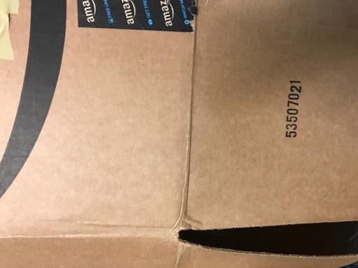
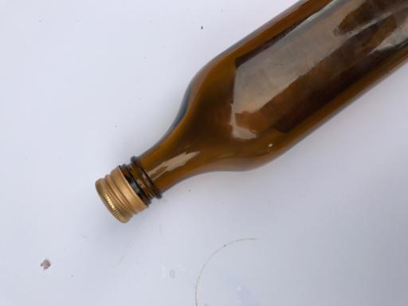
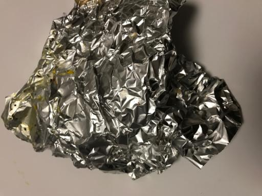
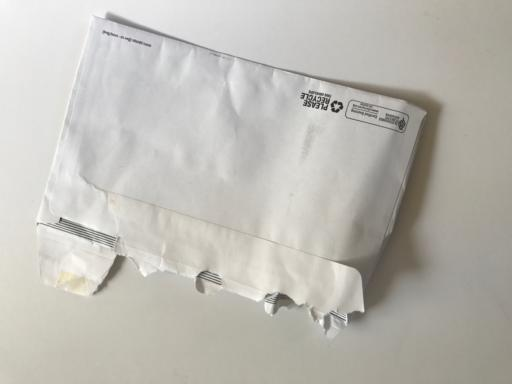
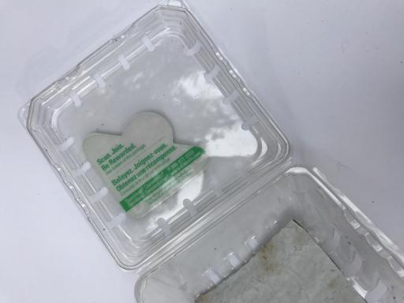
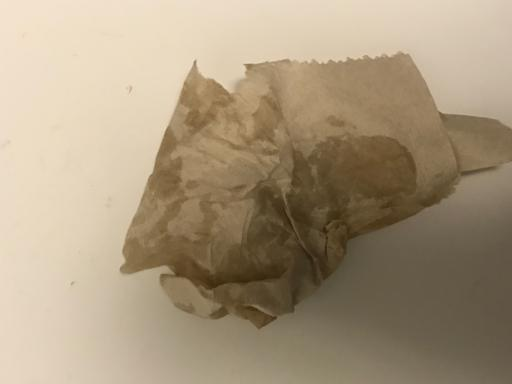
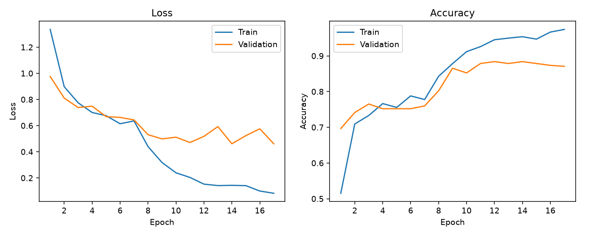
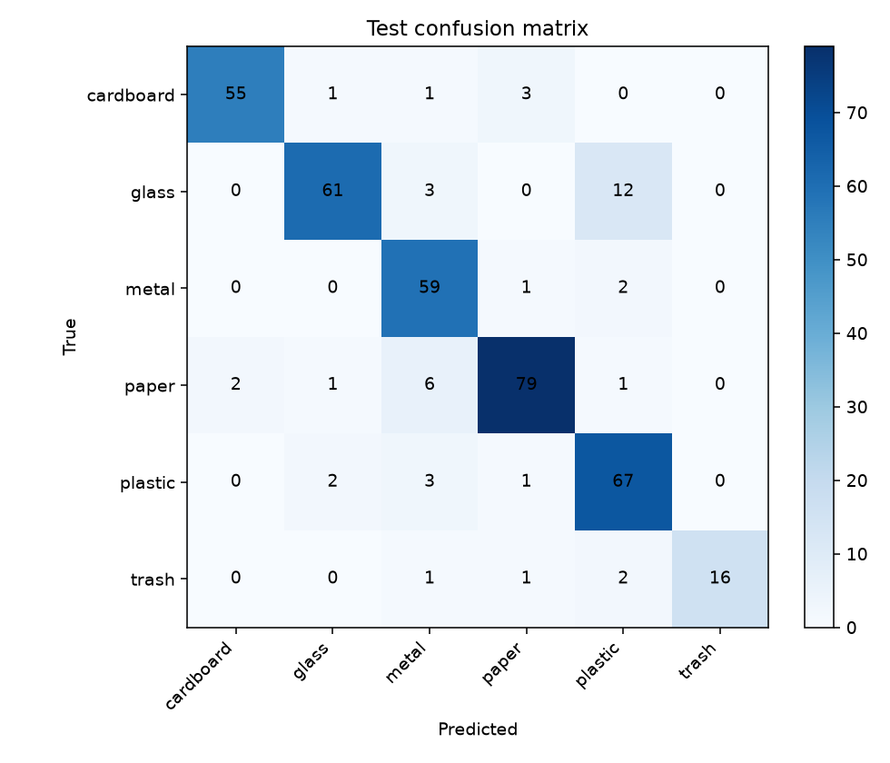

# Waste Image Classification using Transfer Learning

**Student:** Student Name

**Roll number:** Roll Number

**Course:** Deep Learning

## Problem statement

Household and campus waste is easier to recycle when paper, plastic, glass, metal, and cardboard are separated before disposal. Doing that by hand does not scale, and a photograph is often the only signal available at a bin or a conveyor.

This project builds a six-class image classifier for that decision. The classes are cardboard, glass, metal, paper, plastic, and trash. The trained network is saved as a PyTorch checkpoint and as an ONNX file so the same weights can be downloaded for evaluation and run in a browser demo.

The system is an educational demonstration. It is not a controller for hazardous-waste handling, and it was not trained on medical, chemical, or industrial-safety categories.

## Objectives

- Train a convolutional classifier on a public waste-image dataset.
- Keep a held-out test set out of model selection and report accuracy, per-class F1, and a confusion matrix.
- Publish the architecture, checkpoint, and a one-command prediction script.
- Deploy a web page that shows the dataset, the code layout, live predictions, this report, and the presentation.

## Dataset

The images come from TrashNet, collected by Gary Thung and Mindy Yang for Stanford CS 229 and published at [github.com/garythung/trashnet](https://github.com/garythung/trashnet). Each photo shows one object on a plain posterboard under sunlight or room light. The phones used for the original collection were an iPhone 7 Plus, an iPhone 5S, and an iPhone SE. This project uses the resized JPEG release (`dataset-resized.zip`), whose images are 512 by 384 pixels.

The release contains **2527** images: cardboard 403, glass 501, metal 410, paper 594, plastic 482, trash 137. Trash is the smallest class, with 137 images, so a classifier that ignores it can still post a high overall accuracy. Training therefore uses inverse-frequency class weights, and the report includes per-class scores rather than accuracy alone.

The split is stratified with seed 42: **1768** train, **379** validation, and **380** test, about 70% / 15% / 15%. Early stopping watches validation accuracy. The test set is used once, after the checkpoint is chosen.

The full image archive is not committed. `download_dataset.py` fetches it, and `samples/` keeps one correctly classified test image per class for the website and the slides.













## Architecture

The network is `torchvision.models.mobilenet_v2`, initialized from ImageNet-1K weights (`IMAGENET1K_V1`). MobileNetV2 is a stack of inverted residual blocks. A block expands the channels with a 1×1 convolution, filters them with a depthwise 3×3 convolution, and projects them back with a linear 1×1 convolution. Stride-1 blocks add a residual connection when the depth does not change. That design keeps the model small enough to store in Git and to run in the browser.

The ImageNet classifier is replaced by dropout (probability 0.2, the torchvision default) and a linear layer from 1,280 features to 6 classes. The full network has **2,231,558** parameters. Inputs are RGB images. Evaluation resizes the shorter side to 256, takes a center crop of 224, and normalizes with the ImageNet mean (0.485, 0.456, 0.406) and standard deviation (0.229, 0.224, 0.225). The exported model returns logits. Probabilities are a softmax over those six logits.

`model.py` defines `build_model()`. Loading `weights/model.pth` into that module reproduces the trained network. The checkpoint dictionary stores `state_dict`, `classes`, `input_size`, `mean`, `std`, and `arch`.

## Training

Training ran on **NVIDIA GeForce RTX 5070** with batch size 32. The loss is cross-entropy with inverse-frequency weights computed on the training split only: cardboard 1.045, glass 0.842, metal 1.027, paper 0.708, plastic 0.874, trash 3.069. The optimizer is Adam with weight decay 0.0001. Each phase also uses ReduceLROnPlateau on validation accuracy, with factor 0.5 and patience 2.

Training images are augmented with a random resized crop (scale 0.7 to 1.0), horizontal flip, rotation up to 15 degrees, and color jitter of 0.2 brightness, 0.2 contrast, 0.2 saturation, and 0.05 hue. Validation and test images use the deterministic resize-and-center-crop pipeline.

Phase one freezes every feature block and trains the new classifier for up to 8 epochs at learning rate 1e-3, with early stopping patience 3. It ran for **6** epochs. The best head checkpoint is reloaded before fine-tuning.

Phase two unfreezes MobileNetV2 feature blocks from index 14 onward (the later inverted residuals and the final convolution) and trains them at learning rate 1e-4 while the classifier stays at 1e-3. The cap is 20 epochs and the patience is 5. It ran for **11** epochs. The saved weights are the epoch with the highest validation accuracy, **88.39%**, across both phases. In total, **17** epochs were executed.



## Results

On the held-out test set the model reaches **88.68%** accuracy, **88.83%** macro F1, and **88.75%** weighted F1. Macro F1 treats the six classes equally, so the small trash class cannot hide inside the overall accuracy.

| Class | Precision | Recall | F1 | Support |
| --- | --- | --- | --- | --- |
| cardboard | 96.49% | 91.67% | 94.02% | 60 |
| glass | 93.85% | 80.26% | 86.52% | 76 |
| metal | 80.82% | 95.16% | 87.41% | 62 |
| paper | 92.94% | 88.76% | 90.80% | 89 |
| plastic | 79.76% | 91.78% | 85.35% | 73 |
| trash | 100.00% | 80.00% | 88.89% | 20 |



The largest confusions were 12 glass images predicted as plastic; 6 paper images predicted as metal; 3 cardboard images predicted as paper.

The original TrashNet course project reported roughly 75% test accuracy with a smaller convolutional network trained from scratch, on the authors' own split. That figure is context, not a paired comparison: this project uses ImageNet initialization and a different stratified split.

## Web deployment and repository

The static site in `web/` states the problem, the dataset, the code layout, and these results. Uploading a photo, or clicking a sample, runs `model.onnx` with ONNX Runtime Web. The page also links to this report, the slide deck, and the weight files.

Canonical files for an automated check:

- `weights/model.pth` — PyTorch checkpoint
- `weights/model.onnx` — browser copy of the same network
- `weights/config.json` — class order, input size, and normalization
- `weights/class_names.json` — class order alone
- `model_manifest.json` — paths and the prediction command
- `model.py` — `build_model()`
- `predict.py` — prints JSON probabilities for one image
- `outputs/metrics.json` — the numbers in this report

Command-line prediction:

```
python predict.py --image samples/paper.jpg
```

Loading the checkpoint in Python:

```python
import torch
from model import build_model

checkpoint = torch.load("weights/model.pth", map_location="cpu", weights_only=False)
model = build_model(num_classes=len(checkpoint["classes"]), pretrained=False)
model.load_state_dict(checkpoint["state_dict"])
model.eval()
```

Class order in the checkpoint and in the ONNX softmax is cardboard, glass, metal, paper, plastic, trash.

## Limitations

- TrashNet objects sit on a clean posterboard. A photo of a bin, a street, or several overlapping items is outside that distribution, so the demo can be confidently wrong.
- Glass, plastic, and metal are often transparent or reflective, and the confusion matrix is where those mistakes show up.
- The trash class has 137 images in the whole dataset and 20 in the test split, so its F1 is a noisy estimate.
- Inverse-frequency weights push the model to notice trash, but they do not create new photographs.
- Nothing in the label set covers batteries, chemicals, or sharp medical waste. The page should not be used as a safety instruction.

## Reproducibility

```
python -m venv .venv
.venv\Scripts\python -m pip install torch torchvision --index-url https://download.pytorch.org/whl/cu128
.venv\Scripts\python -m pip install -r requirements.txt
.venv\Scripts\python download_dataset.py
.venv\Scripts\python train.py
.venv\Scripts\python build_docs.py
node prepare_site.js
```

CPU training also finishes, because the dataset is small. The CUDA 12.8 wheel is what this machine used for an RTX 5070 (Blackwell, `sm_120`). `train.py` falls back to CPU if a CUDA kernel cannot run.

## References

1. Gary Thung and Mindy Yang. TrashNet. Stanford CS 229, 2016. https://github.com/garythung/trashnet

2. Mark Sandler, Andrew Howard, Menglong Zhu, Andrey Zhmoginov, and Liang-Chieh Chen. MobileNetV2: Inverted Residuals and Linear Bottlenecks. CVPR, 2018.

3. Torchvision MobileNetV2 and ImageNet-1K weights, `MobileNet_V2_Weights.IMAGENET1K_V1`.
